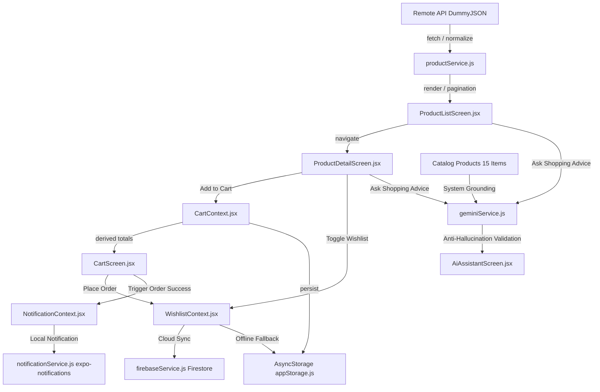

# Integrated E-Commerce Mobile App (MMA301 Assignment 2)

**Học phần:** MMA301 – Multiplatform Mobile App Development  
**Sinh viên:** Trương Hoàng Khang  
**MSSV:** CE190729  
**Nền tảng:** React Native (0.86.3) + Expo (SDK 57)  
**Package / Application ID:** `com.truonghoangkhang.ce190729.ass2`  

---

## 1. Giới thiệu tổng quan (Overview)

Ứng dụng **Integrated E-Commerce Mobile App** là sản phẩm đồ án tích hợp hoàn chỉnh cho học phần MMA301. Kế thừa kiến trúc chuẩn mực và phong cách thiết kế từ Assignment 1, ứng dụng triển khai trọn vẹn chuỗi năng lực di động:
- **Dữ liệu từ xa (Remote Data):** Tải danh mục sản phẩm từ DummyJSON REST API với phân trang vô hạn (`FlatList`), tìm kiếm realtime, lọc danh mục, và cơ chế bảo vệ mạng an toàn (Offline Resilient Fallback).
- **Chi tiết & Giỏ hàng (Detail & Cart State):** Xem thông tin sản phẩm, tính toán giá khuyến mãi, thêm/sửa/xóa sản phẩm, và tự động tính tổng tiền dẫn xuất động (**Derived Totals** – Single Source of Truth).
- **Lưu trữ bền vững (Persistence):** Khôi phục trạng thái giỏ hàng, giao diện (Dark/Light mode) và cấu hình ngay khi ứng dụng khởi động bằng AsyncStorage.
- **Dịch vụ đám mây Firebase (Firebase Cloud Firestore):** Đồng bộ hóa Danh sách Yêu thích (Wishlist) và Lịch sử đơn đặt hàng (Order History) lên Firestore, tự động chuyển về bộ nhớ đệm cục bộ khi ngoại tuyến.
- **Hệ thống thông báo (Notification Workflow):** Quản lý vòng đời cấp quyền (`granted`/`denied`) và phát thông báo cục bộ khi sự kiện đặt hàng thành công hoàn tất.
- **Trí tuệ nhân tạo (Gemini AI Shopping Assistant):** Trợ lý tư vấn mua sắm thông minh neo trực tiếp vào danh mục sản phẩm thực tế trong kho (**Catalog Grounding**), tích hợp bộ lọc chống ảo giác ID (**Anti-Hallucination Guard**) nhằm đảm bảo 100% sản phẩm gợi ý có thể click và mua được.

---

## 2. Kiến trúc thư mục chuẩn (Folder Structure)

```text
mma301-assignment-2/
├── assets/                                 # Biểu tượng ứng dụng, splash screen, adaptive icons
├── docs/                                   # Bộ hồ sơ đánh giá và tài liệu kỹ thuật
│   ├── AI_USAGE_LOG.md                     # Nhật ký sử dụng AI có kiểm soát (6 bước)
│   ├── DEBUG_LOG.md                        # Nhật ký phân tích và sửa 2 lỗi thực tế
│   ├── DESIGN_DECISIONS.md                 # Bản ghi 7 quyết định thiết kế cốt lõi
│   ├── REQUIREMENT_TRACEABILITY_MATRIX.md  # Ma trận RTM (R01 - R12)
│   └── TEST_MATRIX.md                      # Ma trận 15 test cases (Normal/Negative/Edge)
├── src/
│   ├── components/                         # Reusable UI Components
│   │   ├── AiRecommendationCard.jsx        # Thẻ hiển thị sản phẩm được AI xác thực
│   │   ├── Badge.jsx                       # Huy hiệu hiển thị số lượng giỏ hàng
│   │   ├── CartItem.jsx                    # Dòng sản phẩm trong giỏ kèm bộ tăng giảm số lượng
│   │   ├── EmptyState.jsx                  # Màn hình trạng thái trống trực quan
│   │   ├── ErrorState.jsx                  # Màn hình thông báo lỗi mạng kèm nút "Thử lại"
│   │   ├── LoadingScreen.jsx               # Màn hình chờ spinner nạp dữ liệu
│   │   ├── ProductCard.jsx                 # Thẻ sản phẩm dạng lưới trong FlatList
│   │   ├── ScreenContainer.jsx             # SafeArea wrapper & theme động dùng chung
│   │   └── ThemeToggle.jsx                 # Nút gạt chuyển đổi giao diện Sáng / Tối
│   ├── config/                             # Cấu hình API & Dịch vụ (Không chứa secret)
│   │   ├── apiConfig.js                    # Cấu hình DummyJSON & Gemini endpoint
│   │   └── firebaseConfig.js               # Cấu hình template Firebase Firestore
│   ├── context/                            # Global State Management (Context API)
│   │   ├── CartContext.jsx                 # Quản lý giỏ hàng và derived totals
│   │   ├── NotificationContext.jsx         # Quản lý quyền và phát thông báo
│   │   ├── ThemeContext.jsx                # Quản lý chế độ sáng/tối toàn app
│   │   └── WishlistContext.jsx             # Quản lý yêu thích & đơn hàng (Firebase)
│   ├── data/
│   │   └── mockProducts.js                 # Dữ liệu dự phòng an toàn khi mất mạng
│   ├── navigation/
│   │   └── AppNavigator.jsx                # Native Stack Navigator (6 screens)
│   ├── screens/                            # Các màn hình chính của ứng dụng
│   │   ├── AiAssistantScreen.jsx           # Trợ lý mua sắm thông minh Gemini AI
│   │   ├── CartScreen.jsx                  # Giỏ hàng & thanh toán đơn hàng
│   │   ├── ProductDetailScreen.jsx         # Chi tiết sản phẩm & thêm vào giỏ
│   │   ├── ProductListScreen.jsx           # Danh mục sản phẩm, tìm kiếm, phân trang
│   │   ├── SettingsScreen.jsx              # Cài đặt giao diện, API key, thông báo
│   │   └── WishlistScreen.jsx              # Sản phẩm yêu thích & lịch sử đơn hàng
│   ├── services/                           # Tầng dịch vụ độc lập (Separation of Concerns)
│   │   ├── firebaseService.js              # Giao tiếp Firestore (đọc, ghi, offline fallback)
│   │   ├── geminiService.js                # Giao tiếp Gemini AI & chống ảo giác
│   │   ├── notificationService.js          # Xử lý quyền và lịch phát thông báo
│   │   └── productService.js               # Gọi API danh mục, tìm kiếm, phân trang
│   ├── storage/
│   │   └── appStorage.js                   # Helper bọc AsyncStorage có safe try-catch
│   └── utils/
│       └── formatters.js                   # Tiện ích định dạng tiền tệ, ngày tháng
├── .gitignore
├── app.json                                # Cấu hình Expo và Android Package
├── App.jsx                                 # Root Providers & Navigation
├── index.js                                # Đăng ký Root Component
├── package.json
└── README.md
```

---

## 3. Hướng dẫn cài đặt và chạy ứng dụng (Setup & Run)

### Yêu cầu môi trường
- Node.js: `>= 18.x` (Đã kiểm thử trên Node v24.12.0)
- npm: `>= 9.x`
- Thiết bị hoặc máy ảo Android / iOS / Trình duyệt Web

### Các bước khởi chạy
1. **Cài đặt dependencies:**
   ```bash
   npm install
   ```

2. **Chạy ứng dụng bằng Expo:**
   ```bash
   npx expo start
   ```

3. **Tùy chọn nền tảng:**
   - Nhấn `a` trên terminal để mở máy ảo / thiết bị Android.
   - Nhấn `w` để mở trực tiếp trên trình duyệt Web.
   - Quét mã QR bằng ứng dụng **Expo Go** trên điện thoại thật.

---

## 4. Cấu hình bảo mật & Dịch vụ (Security & Services Setup)

Tuân thủ nghiêm ngặt quy định không commit secret vào git repository:
1. **Gemini AI API Key:**
   - Mở app → Nhấn biểu tượng ⚙️ (**Cài đặt hệ thống**).
   - Cuộn đến phần **"Cấu hình Gemini AI API Key"**, dán key cá nhân của bạn vào ô nhập liệu và bấm **"Lưu API Key"**.
   - Khóa API được lưu bền vững và an toàn trong `AsyncStorage` của thiết bị, không bị lộ ra mã nguồn.
   - Nếu chưa nhập key hoặc thiết bị ngoại tuyến, hệ thống sẽ tự động kích hoạt **Safe Rule-based Engine** để tính năng tư vấn vẫn hoạt động đầy đủ.
2. **Firebase Firestore:**
   - Mẫu cấu hình đặt tại `src/config/firebaseConfig.js`.
   - Nếu chưa cấu hình project Firebase cá nhân, ứng dụng tự động kích hoạt chế độ **Local Resilient Persistence** (Lưu trữ an toàn cục bộ), đảm bảo mọi thao tác Yêu thích và Đặt hàng vẫn hoạt động trơn tru 100%.
3. **Notification Permissions:**
   - Hệ thống tự động kiểm tra trạng thái cấp quyền. Bạn có thể bấm nút **"Gửi thông báo thử nghiệm"** trong màn hình Cài đặt để kiểm chứng âm thanh và banner thông báo.

---

## 5. Kiến trúc luồng dữ liệu (State & Data Flow)



---

## 6. Đóng gói bản phát hành (Release Build Evidence)

Ứng dụng đã được kiểm chứng bundling thành công toàn bộ **642 modules** không phát sinh bất kỳ lỗi cú pháp hay thiếu dependency nào thông qua lệnh:
```bash
npx expo export
```
- **Android Package:** `com.truonghoangkhang.ce190729.ass2`
- **Output:** Toàn bộ bundle mã tĩnh sẵn sàng đóng gói APK độc lập thông qua EAS Build (`eas build -p android --profile preview`).

---

## 7. Hồ sơ đánh giá đính kèm (Evaluation Artifacts)

Mọi tài liệu chi tiết phục vụ buổi chấm và phỏng vấn trực tiếp được lưu trữ trong thư mục `docs/`:
1. [Requirement Traceability Matrix (RTM)](./docs/REQUIREMENT_TRACEABILITY_MATRIX.md) – Bảng ánh xạ R01 đến R12.
2. [Design Decision Record (DDR)](./docs/DESIGN_DECISIONS.md) – 7 quyết định thiết kế và phân tích tác động.
3. [Test Matrix](./docs/TEST_MATRIX.md) – 15 test cases chi tiết kèm kết quả thực tế.
4. [Debug Log](./docs/DEBUG_LOG.md) – 2 lỗi kỹ thuật thực tế với quy trình 5 bước.
5. [AI Usage Log](./docs/AI_USAGE_LOG.md) – Nhật ký sử dụng AI có kiểm chứng minh bạch.
# mma301-assignment-2

